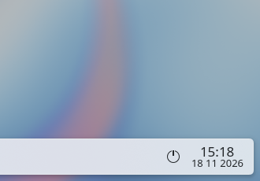
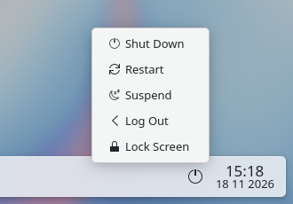

# Power Menu for KDE Plasma 6

Add a power button to your Plasma panel for **Shut Down**, **Restart**, **Suspend**, **Log Out**, and **Lock Screen**.

Shut Down, Restart, and Log Out open Plasma’s native confirmation screen, even if confirmation is disabled in System Settings. Plasma controls which actions are available on your system.

| Panel button | Open menu |
| --- | --- |
|  |  |

## Install

1. Download `power-menu.plasmoid` from the repository’s Releases page.
2. Right-click your panel and choose **Add or Manage Widgets**. Select **Get New… → Install Widget From Local File…**, then open the downloaded file.
3. Search for **Power Menu** and drag it onto the panel.

If you saved the file to Downloads, you can also install it through the terminal. Then add the widget to your panel as above.

```bash
kpackagetool6 -t Plasma/Applet -i "$HOME/Downloads/power-menu.plasmoid"
```

## Build a release

Run this command from the repository root with `zip` installed.

```bash
(cd package && zip -X ../power-menu.plasmoid metadata.json contents/ui/main.qml)
```

Attach `power-menu.plasmoid` to a GitHub release. The applet version is in `package/metadata.json`.

## Compatibility

Requires KDE Plasma 6 and its Plasma Workspace session services. Package installation, menu interaction, and action requests were verified on CachyOS with Plasma 6.8.3 in an isolated Wayland session with simulated action services. Screenshots were taken on a Plasma 6.8.3 panel.

## License

[MIT](LICENSE)
